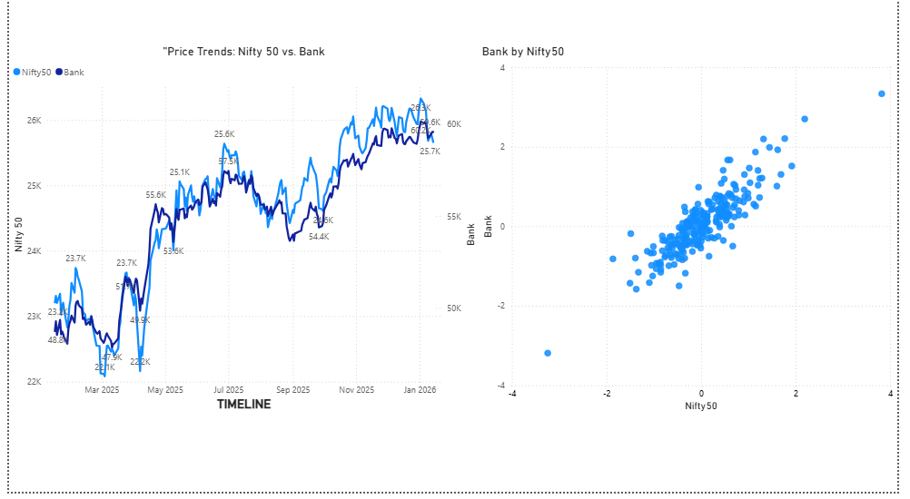
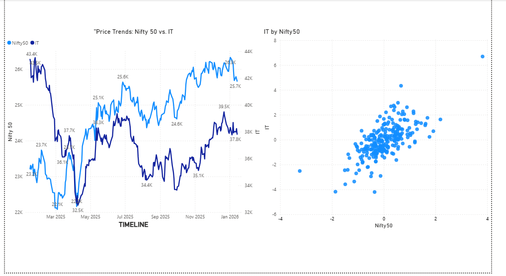
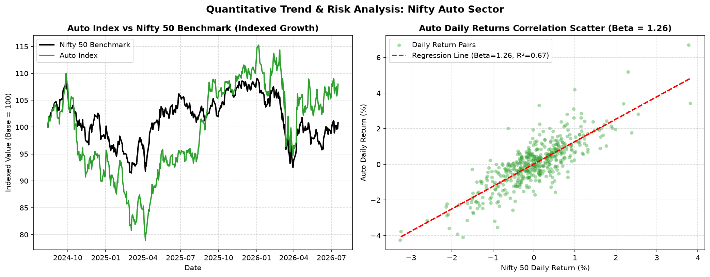
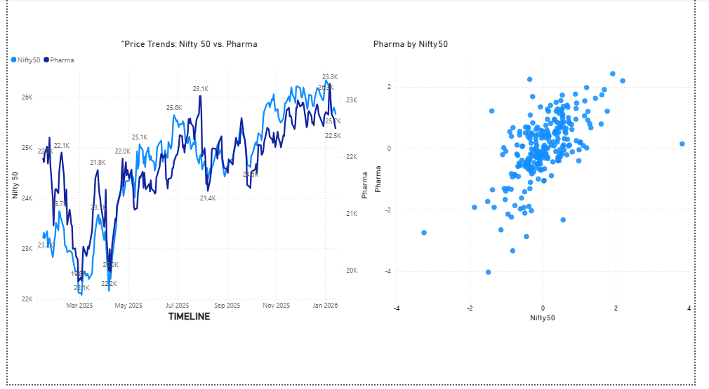

# Financial Market & Sector Analysis: Nifty 50 vs Indian Equity Sectors

A quantitative finance project comparing the Nifty 50 benchmark with major Indian sector indices using beta, correlation, volatility, drawdown, and Sharpe-based analysis.

This project highlights financial analysis, Python-based data processing, and portfolio risk assessment in a presentation-ready format.

---

## Overview

The analysis covers:

- Nifty 50 (`^NSEI`)
- Bank Nifty (`^NSEBANK`)
- Nifty IT (`^CNXIT`)
- Nifty Auto (`^CNXAUTO`)
- Nifty Pharma (`^CNXPHARMA`)

The goal is to evaluate sector risk, benchmark sensitivity, and relative return potential using real market data.

---

## Key Findings

| Sector / Index | Beta ($\beta$) | Correlation ($r$) | CAGR | Volatility | Sharpe | Max Drawdown | Profile |
| :--- | :---: | :---: | :---: | :---: | :---: | :---: | :--- |
| Nifty 50 | 1.000 | 1.000 | +0.42% | 13.41% | -0.39 | -15.77% | Benchmark |
| Bank Nifty | 1.057 | 0.889 | +9.06% | 15.94% | 0.22 | -18.32% | Growth / High Beta |
| Nifty IT | 0.918 | 0.524 | -15.09% | 23.49% | -0.86 | -43.97% | High Volatility |
| Nifty Auto | 1.258 | 0.817 | +4.18% | 20.65% | -0.01 | -28.23% | Cyclical / Sensitive |
| Nifty Pharma | 0.630 | 0.540 | +8.48% | 15.65% | 0.18 | -16.69% | Defensive |

### Takeaway

- Bank Nifty showed the strongest return profile among sectors.
- Pharma was relatively defensive with lower beta and lower drawdown.
- Auto was the most market-sensitive, while IT showed the highest volatility and weak risk-adjusted performance.

---

## Methodology

- Beta: measures sensitivity to movements in the Nifty 50 benchmark.
- Correlation: measures how closely sector returns move with the benchmark.
- Volatility: captures return dispersion over time.
- Sharpe ratio: evaluates return relative to risk.
- Drawdown: measures downside risk and capital decline.

---

## Visual Results

<div align="center">
  
  
</div>

<div align="center">
  
  
</div>

---

## Tech Stack

- Python
- pandas
- NumPy
- yfinance
- Matplotlib
- Seaborn
- SciPy
- Excel
- Power BI

---

## Project Structure

```text
Financial-Market-Analysis-Nifty50/
├── README.md
├── Market_trends_&_sector_analysis.ipynb
├── Market_Sector_Analysis.xlsx
├── Market Trend & Sector Analysis.pbix
├── Trend_Analysis_Bank.PNG
├── Trend_Analysis_IT.PNG
├── Trend_Analysis_Auto.PNG
├── Trend_Analysis_Pharma.PNG
├── requirements.txt
└── .gitignore
```

---

## How to Run

```bash
pip install -r requirements.txt
jupyter notebook Market_trends_&_sector_analysis.ipynb
```

---

## Why this is a strong resume project

- Uses real-world financial market data
- Applies core quantitative finance concepts
- Combines analytics, visualization, and business reporting
- Demonstrates practical Python and data analysis skills

---

## About

This project presents a structured market-risk analysis of Indian equity sectors against the Nifty 50 benchmark and is suitable for a data analytics or quantitative finance portfolio.
