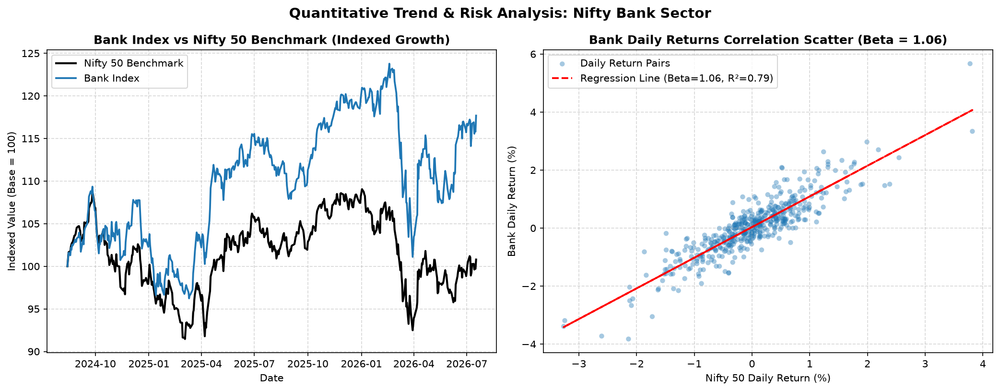
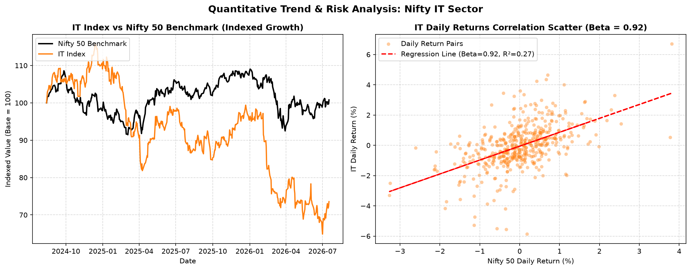
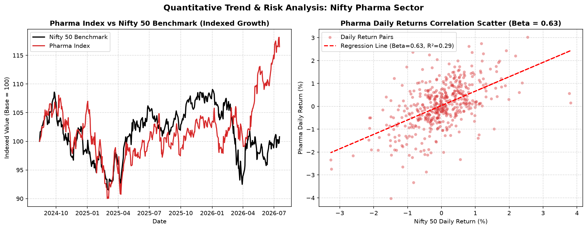

# Financial Market & Sector Analysis: Nifty 50 vs Indian Equity Sectors

A quantitative analysis of the Nifty 50 benchmark and four Indian sector indices, comparing market sensitivity, co-movement, return, volatility, and downside risk. The project combines Python analysis with Excel and Power BI deliverables.

## Executive Summary

This project evaluates Bank Nifty, Nifty IT, an Auto-sector proxy (BAJAJ-AUTO.NS), and Nifty Pharma against the Nifty 50 using historical market data. The analysis calculates beta, correlation, CAGR, annualized volatility, Sharpe ratio, and maximum drawdown to compare sector risk and performance.

**Key insight:** Bank remains the closest benchmark proxy (beta 1.058), Pharma remains the most defensive (beta 0.638), and IT shows the deepest drawdown (-43.97%). The Auto-sector proxy is BAJAJ-AUTO.NS because Yahoo Finance no longer exposes the historical `^CNXAUTO` index ticker.

## Key Findings

| Sector / Index | Ticker | Beta ($\beta$) | Correlation ($r$) | CAGR | Annual Volatility | Sharpe ($R_f=6.5\%$) | Max Drawdown | Profile |
| :--- | :--- | :---: | :---: | :---: | :---: | :---: | :---: | :--- |
| Nifty 50 | `^NSEI` | 1.000 | 1.000 | -6.50% | 13.17% | -0.94 | -15.18% | Benchmark |
| Bank Nifty | `^NSEBANK` | 1.058 | 0.885 | +1.64% | 15.74% | -0.23 | -18.32% | Growth / High Beta |
| Nifty IT | `^CNXIT` | 0.917 | 0.510 | -19.58% | 23.67% | -1.08 | -43.97% | High Volatility |
| Auto (proxy) | `BAJAJ-AUTO.NS` | 1.009 | 0.519 | -3.64% | 25.60% | -0.27 | -38.59% | Cyclical / Sensitive |
| Nifty Pharma | `^CNXPHARMA` | 0.638 | 0.539 | +6.68% | 15.58% | 0.08 | -16.69% | Defensive |

## Charts

| Bank Nifty vs Nifty 50 | Nifty IT vs Nifty 50 |
| :---: | :---: |
|  |  |
| Nifty Auto vs Nifty 50 | Nifty Pharma vs Nifty 50 |
|  |  |

## Methodology

- **Beta:** $\beta_i = \mathrm{Cov}(R_i, R_m) / \mathrm{Var}(R_m)$; measures sensitivity to the Nifty 50.
- **Correlation:** $r_{i,m} = \mathrm{Cov}(R_i,R_m) / (\sigma_i\sigma_m)$; measures linear co-movement.
- **Annualized volatility:** $\sigma_{ann} = \sigma_{daily}\sqrt{252}$.
- **Sharpe ratio:** $(\mathrm{CAGR} - R_f) / \sigma_{ann}$ is a common shorthand, but the notebook calculation uses the annualized mean excess-return version for a direct daily-return comparison. The summary table follows the notebook’s implementation.
- **Maximum drawdown:** the largest peak-to-trough decline over the observation window.

### Sector Profiles

- **Bank Nifty:** High beta (1.057) and strong correlation (0.889) with the benchmark.
- **Nifty IT:** Lower correlation (0.524) and the highest volatility (23.49%) in this comparison.
- **Nifty Auto:** Highest beta (1.258), indicating the greatest historical market sensitivity.
- **Nifty Pharma:** Lowest beta (0.630) and relatively limited drawdown (-16.69%), making it the most defensive sector in this sample.

## Project Structure

```text
Financial-Market-Analysis-Nifty50/
├── notebooks/01_market_sector_analysis.ipynb
├── data/market_sector_analysis.xlsx
├── data/prices_snapshot.csv
├── dashboard/market_sector_analysis.pbix
├── images/
├── requirements.txt
├── LICENSE
└── README.md
```

## How to Run

```bash
git clone https://github.com/shivam-more26/Financial-Market-Analysis-Nifty50.git
cd Financial-Market-Analysis-Nifty50
pip install -r requirements.txt
jupyter notebook notebooks/01_market_sector_analysis.ipynb
```

The notebook downloads adjusted closing prices for the fixed window 2024-10-01 through 2026-10-01 and saves a reproducible price snapshot to `data/prices_snapshot.csv`. The Excel workbook is at `data/market_sector_analysis.xlsx`; the Power BI dashboard is at `dashboard/market_sector_analysis.pbix`.

## Tech Stack

Python, yfinance, pandas, NumPy, Matplotlib, Seaborn, SciPy, openpyxl, Jupyter, Excel, and Power BI.

## Limitations

- The analysis uses a two-year observation window.
- It covers only four sectors.
- Yahoo Finance data can differ on re-download; use the saved `data/prices_snapshot.csv` for reproducible analysis.
- Beta and correlation are historical estimates and may change across periods.
- This project is for educational purposes and is not investment advice.

## License

Distributed under the [MIT License](LICENSE).
